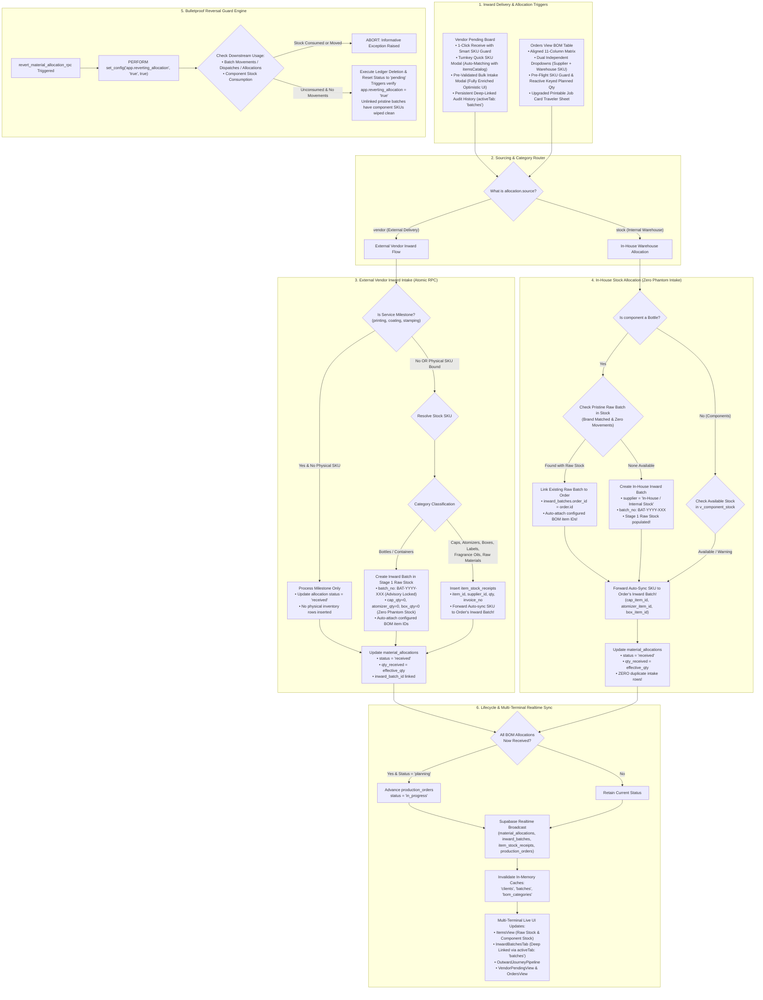

# System Architecture Document

## Order Vendor BOM & Inward Stock Auto-Synchronization Pipeline

**System:** Stock Track Manufacturing & Inventory Platform  
**Architecture Version:** 2.0  
**Target Migration:** `20261118000000_sync_order_allocations_to_inward_stock.sql`  

---

### 1. High-Level Architecture Overview

---

### 2. Database Schema Extensions

#### `material_allocations`
- `qty`: `integer NOT NULL DEFAULT 0` (planned allocation requirement)
- `qty_received`: `integer DEFAULT NULL` (actual intake volume received at factory gate)
- `inward_batch_id`: `uuid REFERENCES inward_batches(id) ON DELETE SET NULL`
- `receipt_id`: `uuid REFERENCES item_stock_receipts(id) ON DELETE SET NULL`
- `location`: `text DEFAULT 'Raw Stock Bay A'`

#### `inward_batches`
- `order_id`: `uuid REFERENCES production_orders(id) ON DELETE SET NULL`
- `allocation_id`: `uuid REFERENCES material_allocations(id) ON DELETE SET NULL`

#### `item_stock_receipts`
- `order_id`: `uuid REFERENCES production_orders(id) ON DELETE SET NULL`
- `allocation_id`: `uuid REFERENCES material_allocations(id) ON DELETE SET NULL`

---

### 3. PostgreSQL Triggers & Constraints

1. **`prevent_received_allocation_delete_trigger`**: Blocks manual SQL or client deletion of allocations in `'received'` status.
2. **`allow_unconsumed_receipt_delete_trigger`**:
   - Checks `current_setting('app.reverting_allocation', true) = 'true'`.
   - If not in an authorized RPC reversal, prevents deleting receipts linked to active order allocations.
   - If reverting, verifies that available component stock in `v_component_stock` has not been consumed.
3. **`allow_empty_batch_delete_inward_batches`**:
   - Checks `current_setting('app.reverting_allocation', true) = 'true'`.
   - Protects immutable ledger columns (`qty_received`, `item_id`, `supplier_id`, `received_on`).
   - Blocks batch deletion if any stage movements, dispatches, or inter-batch allocations exist.

---

### 4. Client State Architecture & Realtime Synchronization

- **Dual Reactive Cache Model**:
  - Multi-table PostgreSQL changes broadcast via Supabase Realtime channels.
  - Channels register listeners for `items`, `inward_batches`, `material_allocations`, `item_stock_receipts`, `stage_movements`, `dispatches`, and `suppliers`.
  - Incoming database events trigger a 250ms debounced cache invalidation (`invalidateCache()`) and silent UI re-fetching.
- **Deep Linking Navigation**:
  - `onViewChange('items', { batchId: batch_no, activeTab: 'batches' })` routes to the Inward Batches ledger and activates batch filtering.
