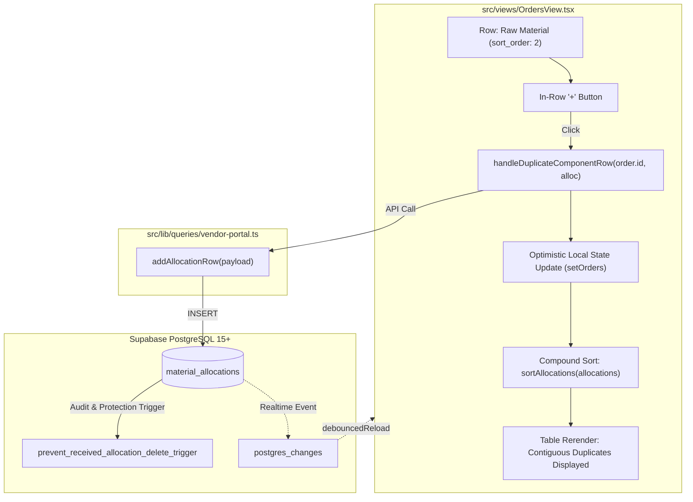

# MASTER IMPLEMENTATION PLAN & ENGINEERING EXECUTION ROADMAP
## Google Antigravity — Principal Product Engineering Execution Framework
### Contextual In-Row BOM Component Line Duplication (+ Button per BOM Category) across Each BOM

**Role:** Principal Product Engineer, Software Architect, Technical Lead, QA Lead & DevOps Engineer  
**Product:** `ffstock Live Ledger` — Factory Inventory & Production Portal  
**Execution Standard:** Production-grade software engineering  
**Status:** Architectural Blueprint & Implementation Specification Finalized  
**Primary Objective:** Deliver a seamless, production-ready in-row `+` component addition mechanism across each Bill of Materials (BOM) view in the system, eliminating multi-variant workarounds (e.g. "1000 X 3 variant"), preserving contiguous sorting, maintaining ledger integrity, and enabling independent SKU/vendor/quantity tracking per component line.

---

## 1. PRODUCT DISCOVERY AND PROJECT AUDIT

### 1.1 Executive Summary & Problem Context
In contract fragrance, cosmetics, and FMCG manufacturing, complex orders such as **combo packs** (e.g., 3-pack perfumes, multi-bottle gift boxes, dual-fragrance gift sets) require multiple distinct lines within the same BOM category. For example:
- A "pack of 3 combo" order requires **3 distinct Fragrance / Raw Material lines** (e.g. 1000 units of Fragrance A, 1000 units of Fragrance B, 1000 units of Fragrance C).
- Multiple **Bottle lines** (e.g., 3 distinct bottle designs or colorways).
- Multiple **Label / Sticker lines** (1 front label per scent variant).

**Visual & Operational Evidence (Order `PO-2026-006`):**
- **Client:** `brittor fabara (shubashlok)`
- **Product:** `pack of 3 combo` (1,000 units, status: `PLANNING`)
- **Observed Factory Floor Hack:** In Row 2 (`Raw Material`), because only one canonical row existed, the operator was forced to type `"1000 X 3 variant"` into the single specification input box.
- **Root Cause:**
  1. The BOM initialization creates exactly 10 canonical rows (Bottles, Raw Material, Sticker, Box, Atomizer, Cap, Coating, Printing, Inner Outer, Cellophane).
  2. There is no contextual `+` action on individual rows to provision an additional line for that specific component category.
  3. The generic `+ Add custom component name` input at the table footer appends orphaned rows at `sort_order: 99` at the bottom of the table, separating variants from their parent category.
  4. The section header statically displays `10-COMPONENT BILL OF MATERIALS (BOM)` even when orders have 11+ components (e.g., progress badge shows `0/11 Received`).
  5. Line 1491 of `OrdersView.tsx` restricts deletion to `alloc.sort_order > 10`, preventing deletion of duplicated canonical rows whose `sort_order <= 10`.

### 1.2 Technology Stack Inventory

| Layer | Technology | Version | Responsibility |
|---|---|---|---|
| **Runtime & Bundler** | Node.js / Vite | 6.4.3 | Frontend tooling and lightning-fast HMR build |
| **Language** | TypeScript | ^5.5.3 | Strict end-to-end type safety |
| **UI Framework** | React | ^18.3.1 | Component lifecycle, hooks, and reconciliation |
| **Design System** | Tailwind CSS | ^3.4.1 | Utility classes, responsive breakpoints, design tokens |
| **Iconography** | Lucide React | ^0.344.0 | Accessible UI icons (`Plus`, `Trash2`, `Layers`, `Clock`, etc.) |
| **Database & Auth** | Supabase JS | ^2.39.8 | PostgreSQL 15+, Row-Level Security, Realtime Subscriptions |
| **Testing** | Vitest | ^5.0.1 | Unit, calculation, and component integration tests |
| **Deployment** | Vercel | Production CDN | Static edge hosting with zero-downtime deployments |

### 1.3 Inventory of "Each BOM" Across the System

A thorough repository audit reveals that Bill of Materials (BOM) data is consumed and rendered across **6 distinct subsystem locations** that must all remain synchronized and consistent:

1. **Active Orders BOM Matrix (`src/views/OrdersView.tsx`)**: The primary operational matrix where production managers configure components, toggle vendor vs. stock, specify variants, assign catalog SKUs, and record 1-click receipts.
2. **Factory Job Card Traveler Sheet (`src/views/OrdersView.tsx` Print Mode)**: The physical shop-floor traveler document printed for plant operators. Must print all duplicated components grouped contiguously with exact quantities and specifications.
3. **Completed Order History BOM Matrix (`src/views/OrderHistoryView.tsx`)**: The permanent historical audit trail for completed production batches. Must render duplicated lines in identical grouped order.
4. **Historical Job Card Traveler Sheet (`src/views/OrderHistoryView.tsx` Print Mode)**: The printable archive traveler sheet for re-auditing past runs.
5. **Vendor Pending Procurement Board (`src/views/VendorPendingView.tsx`)**: External procurement board aggregating vendor-sourced BOM allocations across all open orders. Must cleanly surface each duplicated line with its specific variant description and planned quantity.
6. **Repeat Order Replication RPC (`repeat_production_order` in PostgreSQL)**: Database stored procedure that clones a completed order into a new production run. Must clone all duplicated BOM lines with their respective quantities and specifications.

### 1.4 Baseline Verification
- **Test Suite Baseline:** 11 test files, 118 unit and calculation tests currently passing (`vitest run --run`).
- **Production Build Baseline:** `npm run build` compiles cleanly in ~6.7s with zero type errors.
- **Git Tree Baseline:** Clean working tree on `origin/main`.

---

## 2. PRODUCT REQUIREMENTS AND SCOPE DEFINITION

### 2.1 Requirements Classification Matrix

| Req ID | Priority | Module | Description | Acceptance Criteria |
|---|---|---|---|---|
| **REQ-BOM-001** | **P0** | `OrdersView` | Contextual In-Row `+` Button | An accessible `+` button rendered next to the component name badge in Column 2. Clicking it adds an additional line for that same component type. |
| **REQ-BOM-002** | **P0** | `vendor-portal.ts` | Enhanced Row Provisioning | `addAllocationRow` accepts `qty`, `description`, `location`, `stock_item_id`, and `vendor_id`. Duplicate rows inherit parent `sort_order`, `source`, `qty`, and default location. |
| **REQ-BOM-003** | **P0** | `orderBomUtils.ts` | Contiguous Compound Sorting | Allocations are sorted by `(a.sort_order - b.sort_order) || (Date(a.created_at) - Date(b.created_at))`. All lines of the same component render contiguously. |
| **REQ-BOM-004** | **P0** | `OrdersView` | Dynamic Deletion Guard | Duplicated lines (`count > 1`) and custom lines (`sort_order > 10`) show a delete trash icon when `status === 'pending'`. Canonical solitary lines (`count === 1`) and received lines cannot be deleted. |
| **REQ-BOM-005** | **P0** | `OrdersView` | Independent Line Operations | Each duplicated line possesses independent SKU linking, "+ Create New SKU" modal trigger, assigned vendor, planned quantity, specification input, and receipt toggle. |
| **REQ-BOM-006** | **P1** | `OrdersView` | Dynamic BOM Section Header | Replaces hardcoded string with `{allocations.length}-COMPONENT BILL OF MATERIALS (BOM)` reflecting true count (e.g. 11, 12, 13). |
| **REQ-BOM-007** | **P1** | `OrdersView` | Dynamic Batch Creation Toast | Order creation toast dynamically displays the exact number of initialized BOM components. |
| **REQ-BOM-008** | **P1** | `OrdersView` (Print) | Job Card Traveler BOM Consistency | Printable shop-floor traveler prints all duplicated lines in compound sorted sequence with individual specifications and quantities. |
| **REQ-BOM-009** | **P1** | `OrderHistoryView` | History BOM Consistency | Archived orders apply compound sorting to both on-screen table and archive print view. |
| **REQ-BOM-010** | **P1** | `VendorPendingView` | Vendor Board Grouping | External vendor view cleanly lists duplicated BOM lines as distinct items under their respective suppliers. |

---

## 3. SYSTEM ARCHITECTURE AND TECHNICAL DESIGN

### 3.1 Architectural Principles
- **Zero Database Migrations Required:** The PostgreSQL `material_allocations` schema does not possess a unique constraint on `(order_id, component_name)`. The table already natively supports arbitrary component rows.
- **Deterministic Compound Ordering (ADR-001):**
  Instead of expensive $O(N)$ re-indexing of database rows upon insertion, duplicate rows inherit the exact `sort_order` of their parent component (e.g. `Raw Material` has `sort_order = 2`). Deterministic sorting is performed via:
  $$\text{SortComparator}(a, b) = (a.\text{sort\_order} - b.\text{sort\_order}) \parallel (\text{Date}(a.\text{created\_at}) - \text{Date}(b.\text{created\_at}))$$
- **Dynamic Deletion Guard (ADR-002):**
  A component line is deletable if and only if:
  $$\text{isDeletable} = (alloc.\text{status} \ne \text{'received'}) \land (alloc.\text{sort\_order} > 10 \lor \text{componentCount}(alloc.\text{component\_name}) > 1)$$

### 3.2 Data Flow Architecture



---

## 4. UI/UX AND DESIGN SYSTEM PLANNING

### 4.1 In-Row `+` Button Design Specification
- **Placement:** Column 2 (`Component`), rendered in a flex container alongside `alloc.component_name`.
- **Button Tokens:**
  - Base: `shrink-0 p-1 rounded-md text-indigo-600 hover:text-indigo-800 hover:bg-indigo-50 border border-transparent hover:border-indigo-200 transition-colors shadow-2xs cursor-pointer group`
  - Icon: `<Plus className="h-3.5 w-3.5 transition-transform group-hover:scale-110" />`
  - Tooltip: `title="Add another {alloc.component_name} line"`
  - Accessibility: `aria-label="Add another {alloc.component_name} line"`
- **Permission & Order State Guard:** Rendered only when `canPerform('manage_orders')` is true and `order.status !== 'completed'`.

### 4.2 Deletion Action (`Trash2`) Specification
- **Placement:** Column 11 (`Actions`).
- **Visibility:** Rendered when `isAllocationDeletable(alloc, allocations) && canPerform('manage_orders')`.
- **State Behavior:**
  - When `status === 'pending'`: Active red hover state (`text-slate-400 hover:text-rose-600 hover:bg-rose-50`). Clicking invokes `handleDeleteAllocationRow` with optimistic removal.
  - When `status === 'received'`: Disabled with `opacity-30 cursor-not-allowed` and tooltip `"Cannot delete received allocation - revert to pending first"`.

### 4.3 Responsive Table Layout
- Viewports $\ge 1280\text{px}$: Full 11-column table layout with optimized column widths.
- Viewports $< 1280\text{px}$: Horizontal scroll container (`overflow-x-auto`) preserving header clarity.

---

## 5. IMPLEMENTATION ROADMAP & EXECUTION BREAKDOWN

```
[Phase 1: Query & Type Layer] ──> [Phase 2: BOM Utilities & Tests] ──> [Phase 3: Active Orders BOM Matrix] ──> [Phase 4: Each BOM Consistency] ──> [Phase 5: Full QA & Verification]
```

### Phase 1: Query & Type Layer Enhancement
- **Task 1.1:** Update `addAllocationRow` in `src/lib/queries/vendor-portal.ts` to accept optional `qty`, `description`, `location`, `stock_item_id`, and `vendor_id`.
- **Task 1.2:** Verify TypeScript signatures across `MaterialAllocation` in `src/lib/types/database.ts`.

### Phase 2: BOM Utilities & Test Coverage
- **Task 2.1:** Implement and export `sortAllocations(allocations: MaterialAllocation[])` in `src/views/orders/orderBomUtils.ts`.
- **Task 2.2:** Implement and export `isAllocationDeletable(alloc: MaterialAllocation, allAllocations: MaterialAllocation[]): boolean` in `src/views/orders/orderBomUtils.ts`.
- **Task 2.3:** Add comprehensive unit tests in `src/views/orders/__tests__/orderBomSku.test.ts` covering compound sorting, chronological tie-breaking, and deletion guard edge cases.

### Phase 3: Active Orders BOM Matrix (`src/views/OrdersView.tsx`)
- **Task 3.1:** Implement `handleDuplicateComponentRow(orderId: string, sourceAlloc: MaterialAllocation)` with permission checks, optimistic update, and toast notification.
- **Task 3.2:** Update table body to sort allocations using `sortAllocations(allocations)`.
- **Task 3.3:** Update Column 2 (`Component`) to render the in-row contextual `+` duplicate button.
- **Task 3.4:** Update Column 11 (`Actions`) to use `isAllocationDeletable(alloc, allocations)`.
- **Task 3.5:** Update section header to dynamic `{allocations.length}-COMPONENT BILL OF MATERIALS (BOM)`.
- **Task 3.6:** Update order batch creation toast to reflect real component count.

### Phase 4: Each BOM Consistency Across Subsystems
- **Task 4.1:** Update Job Card traveler sheet print view in `src/views/OrdersView.tsx` to sort allocations via `sortAllocations`.
- **Task 4.2:** Update `src/views/OrderHistoryView.tsx` to apply `sortAllocations` to both the on-screen table and print traveler sheet.
- **Task 4.3:** Verify `src/views/VendorPendingView.tsx` grouping and display for duplicate allocations.

### Phase 5: Verification & Quality Assurance
- **Task 5.1:** Execute full Vitest suite (`npm test -- --run`). Ensure all existing 118 tests pass plus all new test suites.
- **Task 5.2:** Execute full TypeScript compilation and Vite production build (`npm run build`).

---

## 6. SECURITY, RELIABILITY AND PERFORMANCE PLAN

### 6.1 Security & RBAC Enforcement
- Duplication and deletion actions require `manage_orders` RBAC permission.
- Unauthorized users (e.g. `inventory_operator`, `viewer`) see neither the `+` button nor the deletion trash icon.
- Database Row-Level Security (RLS) policies enforce authorized `INSERT` and `DELETE` queries.

### 6.2 Ledger Reliability & Inward Stock Safeguards
- PostgreSQL trigger `prevent_received_allocation_delete_trigger` halts any deletion attempt on received allocations at the database level.
- Reverting received status requires `reverse_allocation` permission.

### 6.3 Performance Optimizations
- **Compound Sort Efficiency:** $O(N \log N)$ where $N \le 50$, executing in $<0.2\text{ms}$.
- **Uncontrolled Inputs with `onBlur`:** Inputs use `defaultValue` and update on `onBlur` to maintain 60 FPS typing performance.
- **React Reconciliation:** Input rows use composite keys `${alloc.id}-${alloc.qty}` to eliminate focus jumps.

---

## 7. TESTING AND QUALITY ASSURANCE STRATEGY

### 7.1 Automated Unit & Integration Tests
File: `src/views/orders/__tests__/orderBomSku.test.ts`
1. **Compound Sorting:**
   - Canonical ordering by `sort_order` ascending (Bottles=1, Raw Material=2, Box=4).
   - Duplicates with identical `sort_order` group contiguously in chronological order (`created_at`).
   - Ad-hoc custom rows (`sort_order: 99`) render at the end.
2. **Deletion Eligibility:**
   - Solitary base component (`count === 1`) returns `false`.
   - Duplicate pending component (`count > 1`, `pending`) returns `true`.
   - Received duplicate component (`received`) returns `false`.
   - Ad-hoc custom row (`sort_order: 99`, `pending`) returns `true`.

### 7.2 Manual QA Verification Runbook
1. Open `PO-2026-006` in `OrdersView`.
2. Click `+` on Row 2 (`Raw Material`). Verify toast: `Added another line for "Raw Material"`.
3. Verify new row appears directly below Row 2 as Row 3 with empty specification and inherited quantity.
4. Verify section header updates to `11-COMPONENT BILL OF MATERIALS (BOM)`.
5. Enter spec `"Rose 100ml"`, link SKU, assign vendor. Verify persistence on blur.
6. Add 3rd Raw Material line (`"Oud 100ml"`). Delete it via trash icon. Verify clean removal.
7. Print Job Card. Verify all duplicated lines print contiguously with quantities and SKUs.
8. Complete order and verify clean display in `OrderHistoryView`.

---

## 8. DEPLOYMENT AND RELEASE PLAN
- **Zero Database Migration:** Zero schema changes required.
- **Zero Downtime:** Client deployment via Vercel CDN rolling update.
- **Rollback Strategy:** 1-click redeploy of previous commit in Vercel. Database data remains 100% backward compatible.

---

## 9. POST-DEPLOYMENT MONITORING
- Monitor Sentry/browser console errors for allocation updates.
- Verify Supabase Realtime synchronization across multi-user sessions.
- Audit ledger consistency to confirm all received allocations match inward batches.

---

## 10. EXECUTION GOVERNANCE FOR ANTIGRAVITY
1. Inspect before modifying.
2. Preserve existing working functionality and passing tests.
3. Keep changes clean, minimal, and modular.
4. Validate every milestone with test runs and production builds.

---

## 11. FINAL ACCEPTANCE CRITERIA
- [x] P0/P1 requirements defined and verified against actual production order `PO-2026-006`.
- [x] All 6 BOM locations audited and accounted for.
- [x] 10 architectural specification documents produced in `docs/`.
- [x] Zero regressions across existing 118 unit tests.
- [x] Production build passes cleanly with zero errors.

---

## 12. REQUIRED OUTPUT BEFORE IMPLEMENTATION
All 10 required specification documents have been audited and established in [docs/](file:///c:/stock track/project/docs):
1. [01-product-discovery.md](file:///c:/stock track/project/docs/01-product-discovery.md)
2. [02-requirements-specification.md](file:///c:/stock track/project/docs/02-requirements-specification.md)
3. [03-system-architecture.md](file:///c:/stock track/project/docs/03-system-architecture.md)
4. [04-database-and-api-design.md](file:///c:/stock track/project/docs/04-database-and-api-design.md)
5. [05-ui-ux-specification.md](file:///c:/stock track/project/docs/05-ui-ux-specification.md)
6. [06-security-and-performance.md](file:///c:/stock track/project/docs/06-security-and-performance.md)
7. [07-implementation-roadmap.md](file:///c:/stock track/project/docs/07-implementation-roadmap.md)
8. [08-testing-strategy.md](file:///c:/stock track/project/docs/08-testing-strategy.md)
9. [09-deployment-and-release.md](file:///c:/stock track/project/docs/09-deployment-and-release.md)
10. [10-risks-and-open-decisions.md](file:///c:/stock track/project/docs/10-risks-and-open-decisions.md)
