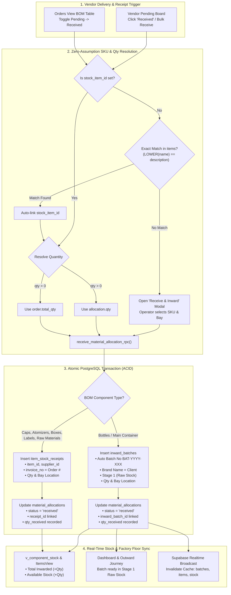

# Implementation Plan: Order Vendor Pending & Inward Stock Auto-Synchronization

**Role:** Senior Staff Product & Systems Engineer  
**Target:** Stock Track Manufacturing & Inventory Platform  
**Status:** Ready for Review & Execution  

---

## 1. Problem Statement & Root Cause Analysis

### Current Broken State
In the current application:
1. **Isolated Procurement Tracker**: When a component is received from a vendor in `src/views/VendorPendingView.tsx` or `src/views/OrdersView.tsx`, the code only updates `material_allocations.status = 'received'` and sets `received_at = now()`.
2. **Missing Inward Ledger Intake**: No entries are created in `inward_batches` or `item_stock_receipts`.
3. **Disconnected Stock Engine**: The live inventory stock calculation in `v_component_stock` and `src/lib/queries/components.ts` relies exclusively on `inward_batches` and `item_stock_receipts`:
   $$\text{Available Stock} = (\text{Batches Inwarded} + \text{Item Receipts}) - \text{Floor Usage} - \text{Scrap} - \text{Dispatches}$$
   Because no inward entry was recorded, the component's warehouse stock stays at **0**.
4. **Missing Relational Fields**:
   - `material_allocations` has no `qty` column (volume received is untracked).
   - In `OrdersView.tsx`, selecting `source = 'vendor'` hides `stock_item_id`, leaving the allocation disconnected from the inventory SKU.
   - Neither `inward_batches` nor `item_stock_receipts` reference `order_id` or `allocation_id`.

---

## 2. Target Architecture & Sync Pipeline



---

## 3. Database Schema Migration Plan

Create migration file: `supabase/migrations/20261118000000_sync_order_allocations_to_inward_stock.sql`.

### A. Add Relational Columns & Indexes
```sql
-- 1. Extend material_allocations with quantity and inward ledger foreign keys
ALTER TABLE material_allocations
  ADD COLUMN IF NOT EXISTS qty integer NOT NULL DEFAULT 0,
  ADD COLUMN IF NOT EXISTS qty_received integer DEFAULT NULL,
  ADD COLUMN IF NOT EXISTS inward_batch_id uuid REFERENCES inward_batches(id) ON DELETE SET NULL,
  ADD COLUMN IF NOT EXISTS receipt_id uuid REFERENCES item_stock_receipts(id) ON DELETE SET NULL,
  ADD COLUMN IF NOT EXISTS location text DEFAULT 'Raw Stock Bay A';

CREATE INDEX IF NOT EXISTS idx_material_allocations_inward_batch ON material_allocations(inward_batch_id);
CREATE INDEX IF NOT EXISTS idx_material_allocations_receipt ON material_allocations(receipt_id);
CREATE INDEX IF NOT EXISTS idx_material_allocations_stock_item ON material_allocations(stock_item_id);

-- 2. Extend inward_batches and item_stock_receipts with backlinks to orders
ALTER TABLE inward_batches
  ADD COLUMN IF NOT EXISTS order_id uuid REFERENCES production_orders(id) ON DELETE SET NULL,
  ADD COLUMN IF NOT EXISTS allocation_id uuid REFERENCES material_allocations(id) ON DELETE SET NULL;

ALTER TABLE item_stock_receipts
  ADD COLUMN IF NOT EXISTS order_id uuid REFERENCES production_orders(id) ON DELETE SET NULL,
  ADD COLUMN IF NOT EXISTS allocation_id uuid REFERENCES material_allocations(id) ON DELETE SET NULL;

CREATE INDEX IF NOT EXISTS idx_inward_batches_order ON inward_batches(order_id);
CREATE INDEX IF NOT EXISTS idx_item_stock_receipts_order ON item_stock_receipts(order_id);
```

### B. Atomic Intake RPC: `receive_material_allocation_rpc`
- **Parameters**: `p_allocation_id uuid`, `p_stock_item_id uuid DEFAULT NULL`, `p_qty_received integer DEFAULT NULL`, `p_location text DEFAULT 'Raw Stock Bay A'`, `p_received_on date DEFAULT CURRENT_DATE`.
- **Logic**:
  1. Row lock on `material_allocations` (`FOR UPDATE`) to prevent concurrent double-receipts.
  2. Resolves effective quantity: `p_qty_received` $\rightarrow$ `allocation.qty` $\rightarrow$ `order.total_qty`.
  3. Resolves inventory SKU (`stock_item_id`).
  4. **Routing**:
     - If `component_name = 'Bottles'` or item category is `'Bottle'`: Generates sequential batch number `BAT-YYYY-XXX` with advisory transaction lock, inserts row into `inward_batches` in Stage 1 Raw Stock, and stores `inward_batch_id`.
     - For all other components (Caps, Atomizers, Boxes, Labels, Raw Materials): Inserts into `item_stock_receipts` with order number reference, and stores `receipt_id`.
  5. Updates allocation: `status = 'received'`, `received_at = NOW()`, `qty_received = v_effective_qty`, `stock_item_id = v_target_item_id`.
  6. Order lifecycle progression: If all allocations for the order are now received and status is `'planning'`, automatically updates `production_orders.status = 'in_progress'`.

### C. Safe Reversal / Undo RPC: `revert_material_allocation_rpc`
- **Parameters**: `p_allocation_id uuid`.
- **Integrity Safeguard**:
  - Checks if an inward batch was generated:
    ```sql
    SELECT COUNT(*) INTO v_movement_count FROM stage_movements WHERE batch_id = v_alloc.inward_batch_id;
    ```
  - If movements $> 0$, raises an exception: *"Cannot revert: Batch has already been moved in production."*
  - If no movements exist:
    - Atomically deletes `inward_batches` or `item_stock_receipts` entry.
    - Resets `material_allocations.status = 'pending'`, `received_at = NULL`, `qty_received = NULL`, `inward_batch_id = NULL`, `receipt_id = NULL`.

---

## 4. Frontend & Application Layer Modifications

### A. TypeScript Models & Queries
1. **`src/lib/types/database.ts`**:
   - Update `MaterialAllocation` with `qty`, `qty_received`, `inward_batch_id`, `receipt_id`, `location`.
   - Update `InwardBatch` and `ItemStockReceipt` with `order_id` and `allocation_id`.
2. **`src/lib/queries/vendor-portal.ts`**:
   - Update `markAllocationReceived` to call `supabase.rpc('receive_material_allocation_rpc', ...)`.
   - Update `revertAllocationToPending` to call `supabase.rpc('revert_material_allocation_rpc', ...)`.
   - Update `batchMarkAllocationsReceived` and `batchRevertAllocationsToPending` to call the atomic RPCs.
   - Add cache invalidations: `invalidateCache('batches')`, `invalidateCache('component_stock')`, `invalidateCache('location_stock')`.

### B. `src/views/VendorPendingView.tsx`
1. **Interactive Receiving Modal**:
   - For items with missing `stock_item_id`, render a quick modal asking the operator to confirm/select the SKU from items catalogue, quantity, and warehouse bay.
2. **Bulk Receive Integration**:
   - Provide feedback on created batch numbers upon marking vendor components received.
3. **Recently Received Tab**:
   - Display inward batch code/receipt ID and link directly to `src/views/items/InwardBatchesTab.tsx`.

### C. `src/views/OrdersView.tsx`
1. **BOM Allocation Table**:
   - Remove mutual exclusivity between `vendor_id` and `stock_item_id`. Allow assigning both **Vendor** (who supplies it) and **Stock SKU** (what item it is in the warehouse).
   - Display allocated quantity `qty` and actual `qty_received`.
2. **Order-Level "Receive Order Stock" Action**:
   - Add a button in the order header to receive all pending vendor components in one coordinated batch.

---

## 5. Verification & Testing Matrix

| Test Scenario | Expected Outcome | Verification Method |
|---|---|---|
| **Receive Bottle Allocation** | Creates `inward_batches` entry (BAT-YYYY-XXX) in Stage 1 Raw Stock | Check `inward_batches` row and verify bottle available stock in `ItemsView`. |
| **Receive Cap / Box Allocation** | Creates `item_stock_receipts` entry | Check `item_stock_receipts` row and verify `v_component_stock.available_stock` increases. |
| **1-Click Undo / Revert** | Deletes inward entry and restores pending status | Verify inventory decrements cleanly and allocation status returns to 'pending'. |
| **Revert Guard on Moved Batch** | Reversal blocked with clear user warning | Perform movement on batch, attempt reversal, ensure error is surfaced. |
| **Missing SKU Handling** | Prompts operator to pick or create SKU | Test receiving allocation without pre-linked SKU; verify modal opens. |
| **Typecheck & Unit Tests** | Zero TypeScript errors, 100% test pass rate | Run `npm run typecheck` and `npm test`. |

---

## 6. Implementation Stages & Execution Order

1. **Phase 1**: SQL migration file creation and deployment (`20261118000000_sync_order_allocations_to_inward_stock.sql`).
2. **Phase 2**: TypeScript data contracts and query mutations in `src/lib/types/` and `src/lib/queries/`.
3. **Phase 3**: UI updates to `OrdersView.tsx` (dual-binding SKU + Vendor, quantity field).
4. **Phase 4**: UI updates to `VendorPendingView.tsx` (modal fallback, 1-click sync, undo integration).
5. **Phase 5**: Full validation run (`npm run check`).
